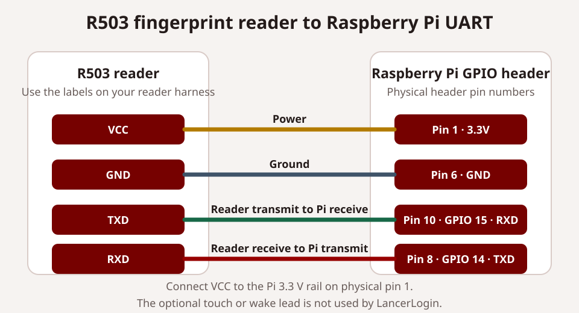

# Physical kiosk

This guide is for Operators who run attendance and Administrators who pair, monitor, or recover a Raspberry Pi kiosk. Supported hardware is a Raspberry Pi 3B+, 4, or 5 with at least 1 GB RAM, a Waveshare 7-inch DSI LCD (E), and Wi-Fi or Ethernet. Administrators can select fingerprint, RFID badge, NFC badge, member ID, or QR code authentication independently for each kiosk. On the Kiosks page, select a device, open **Manage kiosk → Authentication settings**, and save its authentication method. The diagnostic shows the reported method and a waiting-for-sync message until that device applies its configuration. Use the pencil beside a device name to rename it. Fingerprint mode uses an R503 reader; RFID, NFC, and QR mode accept bounded keyboard-wedge input; member ID mode uses the touch display or an attached keyboard.

The dashboard's Kiosks page keeps each physical device's heartbeat, reader, network, queue, sync, and release health together. When Discord is enabled and verified, the same physical-health card lets an Admin or Operator manually refresh the persistent all-kiosk status message; automatic heartbeat and five-minute reconciliation remain best-effort and never block kiosk operation.

## Assemble the enclosure

The enclosure CAD is available in [Onshape](https://cad.onshape.com/documents/255122503ddb0de539e7c548/w/e84888f58700fc04a13850fb/e/b577b6bf33e1b0cef5140c36). Print one case, one case back, and two screen brackets with no support material.

Before opening the electronics packaging, gather:

- Eight M3 heat-set inserts and eight matching M3 × 6 socket-cap screws.
- A Raspberry Pi 3B+, 4, or 5 and a Waveshare 7-inch DSI LCD (E). Add an R503 reader for fingerprint mode or a compatible keyboard-wedge reader for RFID, NFC, or QR mode.
- The display's own Pi mounting hardware and DSI ribbon cable.

Install all eight heat-set inserts in the case before beginning assembly. Use the temperature appropriate for the printed material, press each insert straight into its pocket until flush, and let the plastic cool before threading a screw. The M3 × 6 screws close the printed enclosure at the insert locations. Use the display's supplied mounting hardware for the Pi-to-display connection unless the display documentation specifies otherwise.

1. Put the display face down on a clean, nonconductive surface. Attach the Raspberry Pi to the display with its mounting screws or standoffs. Do not over-tighten the display board.
2. Connect the DSI ribbon cable between the display and Pi. Fully seat both ends, close their retaining tabs, and check the cable orientation against the marks on the boards.
3. For fingerprint mode, press the included reader nut into the matching pocket in the front case. Thread the R503 reader into that nut from the outside of the case. Tighten it only enough to prevent movement and leave the cable free of twists.
4. Lower the Pi-and-display assembly into the case with the display facing the front opening. Keep the DSI cable inside its intended path and do not trap it under a standoff or case edge.
5. For fingerprint mode, connect the R503 lead to the Pi UART using the pinout below. Confirm the reader's printed pin labels before applying power. Do not rely on wire color alone. Connect a keyboard-wedge reader according to its manufacturer's instructions and verify that it emits the complete credential followed by Enter.
6. Fit the two screen brackets, then secure the display assembly using the prepared M3 × 6 screws. Confirm that the screen sits squarely and that no cable is pinched.
7. Place the case back over the assembly, arrange the remaining cable slack away from screw posts, and fasten it with the remaining M3 × 6 screws. Stop if a screw does not start cleanly in its insert.

### R503 UART pinout



Power the reader from the Pi's 3.3 V rail. Confirm the reader's printed pin labels and included wiring diagram before connecting power. LancerLogin uses only the UART connection at the /dev/serial0 device; an optional reader touch or wake lead is not connected.

| R503 label | Raspberry Pi physical header pin | Raspberry Pi signal |
| --- | --- | --- |
| VCC | 1 | 3.3 V |
| GND | 6 | Ground |
| TXD | 10 | GPIO 15 / RXD |
| RXD | 8 | GPIO 14 / TXD |

The transmit and receive lines cross: reader TXD goes to Pi RXD, and reader RXD goes to Pi TXD. If the reader label, voltage requirement, or harness differs from this table, stop and use the reader's supplied wiring documentation before powering the kiosk.

## Install or upgrade the Pi

The Kiosks page links the guided installer from the latest immutable GitHub release. Run it with `--dry-run` to preview or `--install` with `sudo` to proceed. It requires Raspberry Pi OS, Node.js 18 or newer at `/usr/bin/node`, and NetworkManager. Fingerprint mode also requires an enabled UART exposed as `/dev/serial0`.

For an installation without an R503, run `install-lancerlogin.sh --install --no-fingerprint-reader`. The preview prints this choice before making changes. The installer records the disabled sensor setting in a systemd drop-in and skips serial setup. Later no-argument upgrades preserve that local choice. Use `--fingerprint-reader` when intentionally enabling an R503 again. Existing and upgraded installations without either explicit choice continue to default to `/dev/serial0` and fingerprint authentication. `LANCERLOGIN_SENSOR_PATH` remains available for an authorized operator who needs a different `/dev` path.

The installer verifies the Pi model, memory, CPU architecture, artifact digest, selected serial prerequisite, and local service health. It uses a dedicated `lancerlogin` account, installs code under `/opt/lancerlogin`, keeps owner-only state under `/var/lib/lancerlogin`, configures an enabled serial port before every systemd start, and opens local Chromium in kiosk mode at desktop login. When Chromium is installed, it also adds a **LancerLogin Kiosk** desktop shortcut for reopening the local attendance screen full-screen if the Pi is sitting at the desktop. An ordinary upgrade retains pairing, branding, pending events, authentication mappings, the local active-roster cache, and the local settings PIN.

### Release directories and automatic rollback

Each release is installed into its own directory under `/opt/lancerlogin/releases/`. `/opt/lancerlogin/current` links to the active release and `/opt/lancerlogin/previous` to the last healthy one; `/opt/lancerlogin/src` stays a stable link to `current/src`. The installer extracts and checks the new release (syntax, and an import as an unprivileged account with isolated state) while the running release keeps serving scans. Only then does it stop the service, switch `current` with an atomic rename, install the release's systemd units, update helper and polkit rules, and wait up to about 90 seconds for a stable `/health` response.

If the new release does not become healthy, the installer switches `current` back, restores the previous units, helper, polkit rules and `lancerlogin-kiosk.service.d` drop-ins (including `10-version.conf`), restarts the previous release, removes the failed release directory and exits with an error. After a healthy install it keeps only the active and previous releases. Pairing, mappings, the offline queue and other state under `/var/lib/lancerlogin` are never part of a release directory and are not touched by a switch or rollback.

The first update from an older in-place install moves the existing code into `releases/legacy_<version>` and uses it as the rollback target. The installer refuses to continue when `/opt/lancerlogin` holds unexpected files or links, before stopping the running service. An installer from a release before this layout cannot install over it; use the update unit, which always runs the target release's own installer. A power loss during the brief switch leaves either the old or the new release active, never a mix; automatic rollback applies only while the installer is running.

LancerLogin never takes port 8788 from another program. If a pre-community or other kiosk service still uses the port, the installer prints the owning process and exits. Stop or uninstall that service intentionally, then rerun the installer. On a failed health check it prints the current systemd status and recent journal entries.

### Recover the attendance screen after a restart or hostname change

The service and the desktop browser start separately. The service runs as `lancerlogin-kiosk.service`; the browser opens at desktop login through `/etc/xdg/autostart/lancerlogin-kiosk.desktop`. A headless boot does not start a desktop browser. From the signed-in desktop account, open **LancerLogin Kiosk**, or run `/usr/local/bin/lancerlogin-open-kiosk` in that desktop's terminal. Run the launcher as the desktop user, without `sudo`.

A short, orderly service restart preserves still-live page sessions, allowing an open attendance screen to reconnect without a refresh. An open maintenance screen continues to pause attendance. Restarting does not restore PIN authorization, extend expired sessions, or reuse sessions from an earlier boot. After a crash or an expired session, use **Retry attendance** or reopen the attendance screen.

If the screen does not open, first inspect `systemctl status lancerlogin-kiosk.service --no-pager` and `journalctl -u lancerlogin-kiosk.service -n 30 --no-pager`. Check `http://127.0.0.1:8788/health` on the Pi before troubleshooting Chromium. Keep diagnostics private. A healthy service does not prove that a screen has registered attendance presence, or that queued scans have reached the dashboard.

Changing the Pi's hostname changes its `.local` address, not its kiosk pairing or dashboard display name. Check `hostname` and `hostname -I` on that Pi when finding its new LAN address. The installed desktop launcher uses `127.0.0.1`, so it does not need a new URL. Rename the dashboard device separately if desired; do not pair it again just to change a name.

Chromium can refuse an old profile after a hostname change, reporting that it is in use elsewhere. The kiosk uses only the desktop account's dedicated `~/.local/share/lancerlogin/chromium` profile. Before recovering that profile:

1. Close the kiosk browser and its launcher, and confirm that no Chromium process is using that exact profile. Do not remove a lock from an active browser or terminate unrelated browser sessions.
2. As that desktop user, move the dedicated profile to a new private backup folder beside it. Preserve that backup for review. Do not reset the user's general Chromium profile or delete `/var/lib/lancerlogin`.
3. Open **LancerLogin Kiosk** again. The launcher creates a fresh owner-only dedicated profile. If it reports an ownership or permissions problem, inspect the specific profile path instead of changing permissions recursively across the home directory.
4. Confirm the expected kiosk name and pairing, reader/input state, and attendance screen. Complete the PIN-protected date/time confirmation if requested. Use **Retry attendance** if the page session was lost. Review pending scans and rejected records in maintenance, then verify cloud attendance after reconnecting.

Browser profile recovery preserves service-owned pairing, mappings, the queue and the PIN under `/var/lib/lancerlogin`. It does not validate a physical reader or prove that historical attendance is complete.

## Pair without typing deployment details on the Pi

A fresh install starts an unpaired local page and prints both `http://<hostname>.local:8788/` and the Pi's LAN IP fallback. On a phone or laptop connected to the same network:

1. Open dashboard **Kiosks** and choose **Add kiosk**.
2. Name the device and create the ten-minute one-time pairing key.
3. Open the Pi address printed by the installer.
4. Paste the single combined key, enter the six-digit setup code shown on the kiosk's own screen, and choose **Pair kiosk**. Pairing on the kiosk itself needs no setup code.
5. Return to Kiosks and refresh status.

The combined key contains public routing information, the chosen kiosk name, and a single-use code. The Pi sends it directly to the adopter-owned Worker, clears the field, discards the combined key, and stores only the returned kiosk credential with owner-only permissions. D1 stores only hashes of the pairing code and device credential.

LAN clients can reach setup assets, minimal health state (`ok`, `paired` and setup state only), and first pairing with the on-screen setup code. Five wrong codes replace the code and pause LAN pairing for a minute. Attendance, identity input, network, mapping, and maintenance controls require a request from the Pi itself, addressed to the kiosk by its own name or address. Once paired, the pairing endpoint refuses another key.

### Unpair and move to another installation

On the kiosk itself, open **Authentication maintenance**, unlock with the local settings PIN, and choose **Unpair kiosk**. The confirmation identifies the current installation. Read the state-retention notice, select its acknowledgement, then confirm. This local control works even when the roster or old installation is unavailable, provided no attendance scans remain pending.

Unpairing stops installation work and refuses to continue while saved attendance scans are pending, enrollment is active, or a restart/update is underway. Reconnect and let pending scans sync first. It archives the old pairing credential, attendance history, roster cache, authentication mappings and fingerprint sharing state in owner-only storage under `/var/lib/lancerlogin/reassociation/<archive-id>/`. Wi-Fi connections and the local settings PIN remain unchanged. It never erases reader fingerprints or automatically restores archived state.

The service restarts and returns to the pairing screen. Create a fresh one-time key in the destination dashboard, then follow the pairing steps above. The new installation starts without the old roster, slot/badge/QR mappings or peer trust. Re-enroll members or use the destination's separately authorized fingerprint storage; an occupied reader slot is not proof of a member's identity. Do not copy archived mappings, credentials, queues or keys into the new pairing.

Unpairing is local, not server-side retirement. Once the replacement pairing is verified, an Administrator should retire the old device entry in the original dashboard. Until retirement, its archived credential is still sensitive and may remain server-valid. Keep the archive private, just like a kiosk backup.

Archives are temporary. Pairing the kiosk again deletes every archive of earlier installations, and an archive is also deleted 30 days after unpairing (checked only while the kiosk clock is confirmed). Copy anything you must keep, such as unsynchronized rejected-scan evidence, to protected storage before pairing again. Deletion renames the archive first and finishes an interrupted deletion on the next start. On flash storage this removes the files from the filesystem but cannot guarantee that the underlying blocks are physically erased; protect or wipe the card itself when a device leaves the organization.

If power or file access interrupts archival, scanning, pairing and installation mutations stay blocked. Unlock maintenance and choose **Unpair kiosk** again to finish that same archive transaction. A damaged journal, unsafe permissions, symbolic links or state paths outside the standard state directory require an owner-reviewed recovery; do not delete the journal or restore old state to bypass the boundary. A custom installation must keep all installation state directly in or beneath its pairing directory and keep the PIN file directly in that directory.

## Choose the authentication method

An Administrator selects a physical device on dashboard **Kiosks**, opens **Manage kiosk → Authentication settings**, and saves that device's authentication method. Existing kiosks keep their effective configured method during the per-device upgrade; new pairings start with fingerprint. Each device receives only its own configured method on its normal sync. The dashboard separately shows the method most recently reported by the selected kiosk. When those values differ, the change is pending or unconfirmed; stale reader health is not relabeled as proof that the new method is active.

RFID, NFC, and QR support expects a reader that behaves like a keyboard and submits one complete token with Enter. LancerLogin does not add a camera, vendor SDK, or direct device driver for those methods. Reader models, key layouts, prefixes, suffixes, USB behavior, and physical placement must be validated on the installation's hardware. This software acceptance does not claim live RFID, NFC, QR camera, R503, or Pi validation.

LancerLogin permits multiple active physical kiosks. Each active kiosk has a unique device name, credential, pairing identity, heartbeat, command queue, and owner-only local state. Pairing another device leaves all existing kiosk credentials active. Retire only the specific kiosk that should stop working; its historical records are retained and every other active kiosk continues normally.

Every new pairing gives that kiosk a pairing identity. New scans capture that identity when they enter the local queue, and replay sends the captured value. A scan queued by one kiosk can never attach to another kiosk's pairing. The Worker rejects it, and the originating kiosk retains it in **Review rejected scans** with a pairing-mismatch explanation. Do not copy a queue between devices or into a newly paired installation.

An existing Community kiosk upgraded in place remains compatible with queue entries created before pairing identities existed. That legacy acceptance applies only to the retained pre-upgrade credential. Retirement, portable dashboard restore, or re-pairing that device ends it. A portable entire-installation restore invalidates every restored kiosk credential and pairing code, so each physical kiosk must be paired again after the restore.

## Everyday scanning

The local service captures one identity using the configured method. A member presents an enrolled finger, badge, NFC credential, or QR code, or explicitly enters a member ID. There is no meeting selector or administrator control on the normal screen. The kiosk resolves the input to an active member locally, then the shared pipeline applies the same debounce, pairing capture, offline queue, retry, and rejection behavior. The Worker selects the one eligible meeting from the original timestamp. Meeting attendance windows cannot overlap, including the shared late-scan allowance.

The first accepted scan welcomes the member and records arrival. The second says goodbye and records departure. The screen provides ready, processing, welcome, goodbye, unknown-identity, rejected, input-unavailable, and cloud-offline feedback. In fingerprint mode, the R503 aura light mirrors the applicable states. An eight-second member debounce prevents one held finger or duplicate wedge read from producing both scans.

Member ID entry and stored credential mappings are checked against the owner-only active-roster cache. A deactivated or unknown member fails closed locally, even when an older badge mapping remains. After the kiosk has completed one roster sync, that cache supports offline identity resolution. Attendance delivery remains in the same durable offline queue for every method.

Organization name, subtitle, logo, logo contrast treatment, and colors are cached locally. A transparent logo uses the configured adaptive backdrop. If cloud delivery fails, the durable local queue retains events in order and retries. Each saved scan is one small fsynced append to an owner-only journal, which is folded back into the queue files periodically and on an orderly service stop, so a long outage does not rewrite the whole queue for every scan. Only a recognized rejection reason from the Worker (for example an inactive roster member, no eligible meeting, attendance already complete or a pairing mismatch) is final. Any other client error, such as a bare `404` during a deploy or a proxy misroute, keeps the scan queued and retries with backoff of up to 15 minutes. Server rejections move out of the pending list so later valid scans can proceed, but remain in an owner-only local review record with a safe reason code. Review counts remain in protected maintenance and administrator diagnostics, including when no scans are pending. The public attendance screen does not show administrative review counts. The footer keeps the dashboard-configured kiosk name, running release, reader status, queue count and uptime on one line. A dashboard rename is retained for an offline restart. Very long names are shortened visually while their full accessible text remains available.

If the kiosk starts without a verified clock, attendance pauses and the screen offers **Open maintenance**. Enter the local settings PIN, then confirm the current date and time against a trusted clock. The form shows the kiosk's local time zone and the full selected date before confirmation. No event selection is required. Confirming returns to the attendance screen; normal meeting selection occurs in the cloud from each saved scan timestamp when connectivity returns. This confirmation establishes the attendance clock without changing the operating system clock.

The kiosk saves a protected time reference with the Linux boot identity and elapsed time. Network synchronization establishes this reference automatically; an operator's date/time confirmation can establish it while offline. A service restart in the same boot retains it. After a power cycle without network time, confirm the date and time again. Previously saved, verified scan timestamps remain unchanged and sync automatically, including after a reboot or a lost acknowledgement. Later network synchronization improves the clock for new scans without rewriting timestamps that may already have reached the server. Operator-confirmed timestamps are only as accurate as the entered time.

Unverified scans retained from the same boot can be dated once a time reference is available. Scans from another boot without a saved time reference, including older queue entries without clock evidence, move to local review instead of being assigned a guessed date. Their original device timestamp and any boot evidence remain protected locally. Do not infer actual arrival or departure times from an unverified device timestamp. Use the dashboard's audited attendance correction after reviewing the event and member evidence.

Offline queued scans keep **Welcome** or **Goodbye** as the headline, with exactly **Saved for sync | Welcome** or **Saved for sync | Goodbye** beneath it. This is a display estimate, not confirmation: the Worker still resolves attendance from the original timestamp, and queued events contain no inferred direction. Each member's currently pending sequence starts with Welcome and alternates; all fingers mapped to that member share the sequence. Other members, unknown fingers and debounced scans do not advance it. A failed local save shows a rejection instead of claiming the scan was saved.

If a network replay takes more than one second, the scanner shows the saved-for-sync estimate and resumes reading fingers while delivery continues. A later replay result does not change that earlier screen message. The operator review record captures later server rejections.

No extra direction history, member labels or biometric data are persisted. After a service restart, the existing durable queue supplies the pending sequence. Confirmed, duplicate and rejected events stop contributing when replay removes them; subsequent scans recalculate from the remaining queue, including after partial replay or background sync. When a member has no pending events, the next offline sequence starts at Welcome regardless of earlier confirmed attendance. This conservative reset can differ from the final Worker outcome. Reconnection never changes an already displayed estimate into cloud confirmation; directly acknowledged scans keep the normal authoritative feedback. Outside a scan, the network indicator continues to show connection/cloud availability.

After unlocking the local settings PIN in maintenance, choose **Review rejected scans**. The local page shows the scan time, roster member ID, event ID, and a safe rejection reason; uncertain timestamps are explicitly labeled as unverified device time. Check the meeting, roster, and attendance in the dashboard before using its audited correction workflow. **Mark reviewed** only records that the local item was examined; it never creates or changes attendance. An owner-only outcomes file retains the rejected item after review. Once the paired installation has acknowledged a retained record, the kiosk removes it locally after 30 days, or earlier, oldest first, when more than 1,000 acknowledged records are retained; the dashboard keeps it for review. Records the cloud has not acknowledged are never removed, and the saved and rejected counts include removed records. The pending queue snapshot remains in its release 1.0.6 array format with additive clock evidence; recent changes live in an append-only journal beside it that the kiosk replays on start. Upgrading reads existing queue files unchanged and keeps every event ID, and an orderly stop folds the journal back so a reinstalled older release still sees every saved scan. Local `/health` reports saved, pending, accepted, duplicate, rejected, needs-review and clock-pending counts since outcome recording began, plus current clock verification. Heartbeats report an offline queue issue while scans need review or clock confirmation, including when pending is zero. These are kiosk-observed outcomes: an acknowledgement lost during power interruption can appear as a duplicate on retry even when the Worker had accepted the first attempt. An upgraded queue marks earlier history as incomplete, and running older kiosk code again can leave a gap in these counts. The counts do not include scans that were never saved locally. Do not downgrade to kiosk code that ignores clock evidence while unverified scans remain queued.

Compatible kiosks also synchronize retained rejection records to their paired installation during the normal heartbeat. The record includes member and event identifiers, the observed timestamp, rejection reason and available clock evidence, plus review status. It contains no fingerprint template or raw credential. Records remain protected locally and retry after an outage. The kiosk stores the cloud acknowledgement of each record, so a restart does not resend settled history. Records the cloud holds as open are checked again hourly so a dashboard review reaches the kiosk; a record the cloud reports as reviewed is not sent again, and a local review is sent on the next heartbeat. A reviewed item never reopens merely because the other side has older status. Portable restoration revokes kiosk credentials and does not include this cloud review list. Preserve local rejection evidence separately before retirement or re-pairing; see [backup and restore](BACKUP-RESTORE.md). Review synchronization with an older API may be unavailable without interrupting attendance delivery.

## Fingerprint storage locks on Linux

Fingerprint reset, identity, upload and import state uses owner-only persistent
lock directories with Linux kernel locks. The kernel releases ownership when a process
exits, including a forced stop. The `.lock` directories remain on disk normally;
their presence alone does not mean synchronization is blocked. Do not remove them
while the service is running. The kiosk requires `/usr/bin/flock` from util-linux.

Regular lock files left by older versions still require local recovery.
Stop the service, verify no writer remains and validate the protected state before
archiving an abandoned legacy lock. Never reset mappings or discard a pending reset
to bypass a lock error. When downgrading to a version using exclusive-create locks,
stop all writers and archive the lock directories before starting the older code.
State validation, pairing checks and unfinished reset recovery remain mandatory.

## Touch Wi-Fi settings

Press and hold the network dot for three seconds. Small finger movement during the hold is allowed; releasing early or moving too far cancels it. On first use, create a 6–12 digit local settings PIN; later visits require that PIN and five failed attempts lock entry for 30 seconds. An authorized session lasts five minutes.

The page shows NetworkManager connection state and visible Wi-Fi networks, including signal and lock indicators. Select a network and use the on-screen keyboard. The password is passed to NetworkManager for connection and is never saved or displayed by LancerLogin. Ethernet continues to work without configuration.

Captive-portal automation is unsupported. Complete a portal outside LancerLogin or use Ethernet/offline-first scanning until normal connectivity is available.

## Authentication maintenance

Press and hold the organization logo or name for three seconds, then enter the same local settings PIN. When clock confirmation is required, the attendance screen also shows an **Open maintenance** button. Small finger movement during the hold is allowed. Before unlock, the maintenance page shows PIN entry and a return-to-kiosk link. Maintenance is deliberately available only on the physical kiosk.

Attendance capture pauses while maintenance or its network, fingerprint-sync and review tools are open, including while the PIN is locked or expires. Earlier queued scans continue syncing. Use Return to kiosk to resume attendance. If a local page session is lost, reopen or retry the attendance screen; a cloud outage alone does not stop offline capture. Presence leases use elapsed time, so a network clock correction after an offline boot does not expire an active screen session. In fingerprint mode, lift any finger from the reader before placing it for the next attendance scan.

For RFID, NFC, or QR, choose an active roster member, optionally add a local label, then present or enter the credential. LancerLogin transforms the value with HMAC-SHA256 and an owner-only kiosk secret. Only the keyed digest, member mapping, method, and label remain after submission. The raw value is cleared after both success and failure, and is also cleared when maintenance locks or reloads. The digest and secret are co-located on the kiosk, so this boundary prevents routine disclosure and cloud propagation but does not protect against an attacker who already has owner-level access to the Pi.

The credential list never displays raw values. Mapping removal is local and confirmed in the page. Member ID mode needs no mapping; the maintenance page explains that it uses the active-roster cache. Switching methods does not copy a credential between methods.

### Fingerprint enrollment

An Administrator can start enrollment from a fingerprint kiosk's **Manage** page in the dashboard, then select the member there. The kiosk opens a dedicated enrollment screen and asks **Is this you?** before listening. Confirm the name on the physical kiosk, then follow the first scan, lift finger and second scan prompts. **No, not me** cancels the session so the Administrator can start a fresh one. Dashboard enrollment lasts at most five minutes and permits enrollment only, without unlocking other maintenance tools or the local PIN session. It selects a verified free reader slot and cannot replace an occupied slot. Cancellation, expiry, loss of authority or a changed pairing stops further enrollment work; a template already stored on the reader is not erased.

Local PIN-protected maintenance remains available for local enrollment and explicitly confirmed replacement. The **Enrollment** and **Fingerprint mappings** tabs share the main workspace beside the reader status panel.

Opening authorized fingerprint maintenance automatically tests the reader and displays the result. Use Test to retry a failed check. Hardware testing does not require a successful roster refresh.

Choose a member with the nearly full-screen search view. Its mobile-style keyboard supports letters, digits, spaces and punctuation, with Shift, Backspace and a numbers/symbols toggle. Hide the keyboard to give the roster more space. Swipe the list to reach every member; tapping selects a member while swiping does not. Enter a slot from 0-199 with the number pad. Controls remain reachable on the supported landscape displays.

Enrollment requires a successful current online roster check with a verified member identity. If the connection fails, times out or cannot verify the selected member, retry after restoring connectivity. The failed check does not write a new reader template or remove the previous replacement mapping. Existing offline attendance continues normally.

Review the large centered enrollment summary, then confirm or cancel before reader listening begins. Replacing an occupied slot still requires explicit confirmation. Cancellation starts no sensor operation. After successful enrollment, the member search and selection clear automatically. A failed enrollment keeps the selection for retry. Finger labels are no longer requested or shown in the mapping list; historical mapping labels remain compatible.

Mapping removal retains the sensor template. Return to kiosk closes the local PIN session. Expiration hides the workspace and open pickers, and requires unlock again; it does not resume attendance behind maintenance.

The member presents the same finger twice; the R503 creates and stores the template internally. Lift the finger when prompted after the first capture, then place the same finger again. After enrollment is saved, lift the finger again before returning to attendance. A finger left on the reader must not become an attendance scan. If the reader disconnects after storage, enrollment may already be saved; resolve the reader/removal warning rather than immediately replacing the occupied slot. Slot suggestions check the reader's occupied slots as well as local mappings, so a fresh SD card cannot make existing fingerprints appear available for replacement. Enrollment checks occupancy again before capturing a finger and refuses to proceed if that check fails. Replacing an occupied slot requires explicit confirmation even when its local mapping is missing. Reader errors are shown as plain recovery guidance rather than protocol codes.

The owner-only local mapping records the sensor slot and roster member ID, retaining legacy fields for compatibility. New verified enrollments record an enrollment identifier, time and immutable roster identity for optional sharing. Historical local-only or legacy mappings without this identity require fresh online enrollment before sharing. Review-derived mappings are not fresh enrollments. Removing a mapping does not delete the sensor template. With cloud storage off, templates stay inside the R503. With cloud storage enabled, eligible templates are read briefly into memory; raw templates are not intentionally written to files or logs.

Badge and QR raw values, keyed digests, and the kiosk secret are never included in Worker requests, D1, logs, fixtures, or portable dashboard backups. Portable restore, Attendance disablement, and kiosk retirement revoke server-side records but cannot remotely erase local mappings or R503 templates. Before repurposing or decommissioning a Pi, open **Authentication maintenance** on that device and remove its local mappings. LancerLogin intentionally provides no remote destructive wipe.

### Return to the desktop

In unlocked maintenance, choose **Exit to desktop** to close the dedicated kiosk browser. The local kiosk service and delivery of queued scans continue running. Attendance capture remains paused until the kiosk attendance screen is reopened. Use the **LancerLogin Kiosk** desktop shortcut to relaunch it.

Exit is available only when the installed dedicated launcher is connected. An ordinary browser window or older launcher may report that desktop exit is unavailable. LancerLogin does not close unrelated browser windows or use a general process-kill command.

### Diagnose fingerprint synchronization

The authenticated fingerprint-sync tools show separate reset-recovery and cloud-storage status, with the latest attempt, historical success and actionable reasons where available. Attendance cloud connectivity alone does not establish that fingerprint sharing is ready.

Disabled sharing, an unavailable reader or roster, rejected cloud authentication, pending reset recovery and protected-state problems need different remedies. Follow the displayed guidance. An earlier successful poll is historical evidence, not confirmation that a later transfer succeeded. A count of enrollments without verified roster identity means those members need fresh online enrollment; it is not permission to infer identities or delete mappings.

Do not delete state locks, rewrite journals, overwrite unknown slots or wipe the reader to clear a diagnostic warning. Differing mapping counts between devices do not prove duplicate fingerprint templates.

### Provision new kiosks from encrypted cloud copies

**Settings → Attendance → Fingerprint sharing → Fingerprint cloud storage** is a separate Admin opt-in, off by default. Its server-managed key allows a newly paired R503 kiosk to receive retained verified fingerprints while every other kiosk is offline. Confirm organizational permission for this biometric storage and preserve the separate installation key. The server can decrypt the stored copies; this is not peer-only end-to-end encryption.

1. As an Admin, enable cloud storage and accept its explicit confirmation.
2. Leave a source kiosk online while identity-verified mapped fingerprints upload. Existing mappings without immutable identity require re-enrollment while the kiosk is online. Unknown reader slots are untouched.
3. Pair a new compatible kiosk normally. While online in fingerprint mode, it automatically imports verified active-member templates into safe free slots. Source kiosks do not need to be online after their upload completes. Slot numbers may differ between kiosks.
4. Present a known enrolled finger to confirm recognition and use a valid active meeting when checking attendance. Cloud or browser tests alone do not establish physical reader acceptance.

Polling handles two source captures and an eight-item manifest per pass, so large enrollments take multiple polls. An unavailable server, expired roster check, retired credential, full reader, changed immutable member identity or ambiguous journal stops the affected transfer. Existing attendance queues and reader contents remain intact. Completed metadata prevents a removed local mapping being silently recreated after restart. Do not overwrite unknown occupied slots or re-enroll to bypass a recovery mismatch. Do not edit journals or delete locks to bypass recovery.

Cloud storage retains distinct verified models while the member is active, up to 20 per member and 20,000 per installation. Removing a local mapping or replacing a local enrollment does not retract older cloud templates or copies on other readers. Member deactivation or ID change removes their live cloud templates. Disabling cloud storage, disabling Attendance or restoring the installation removes cloud authority and ciphertext. Source retirement does not erase an otherwise valid member enrollment. No option remotely wipes readers. See [PRIVACY.md](PRIVACY.md) and [BACKUP-RESTORE.md](BACKUP-RESTORE.md).

Legacy identity review has been removed. A roster lookup cannot establish who owns an existing sensor template. Re-enroll the member through PIN-protected Authentication maintenance while the kiosk is online to obtain a fresh immutable identity. Retired review grants and imported descendants cannot become fresh upload sources. Updating software does not automatically reset mappings or erase the reader.

A mappings-only reset clears cloud copies and fingerprint mappings on each currently paired kiosk as it reconnects. Offline kiosks remain pending until they durably clear mappings and acknowledge the command. Local enrollment and mapping edits pause during an interrupted reset, and a lost server acknowledgement retries without clearing a later enrollment. Pairing, attendance queues, local settings PIN and alternative credential mappings remain unchanged. Previous sharing keys and journals remain in a non-active reset namespace for recovery. Peer sharing remains retired; cloud sharing resumes only after the pending reset is acknowledged and its current authorization checks pass.

This reset does not erase reader templates or free reader slots. Existing enrolled fingers may trigger the reader's duplicate-fingerprint check. Use an available slot for a genuinely new finger, or the existing explicitly confirmed occupied-slot replacement workflow when replacing a known enrollment. Do not overwrite unknown slots, edit private proof state or remove recovery locks to bypass a pending reset. Removing a local mapping retains its reader bytes and is not template erasure. Physical reader acceptance and duplicate handling still require device testing.

### Retired peer fingerprint sharing

Cloud storage is the only supported fingerprint synchronization path. Peer enablement, approval, registration and transfer endpoints are retired. Older clients receive disabled peer metadata; transfer requests are rejected. Upgrading does not enable cloud storage automatically or delete reader templates, local mappings, historical keys, encrypted outboxes or import journals. Preserve this protected historical state for recovery. Previously retained relay ciphertext and backups are not erased by this software change; any historical cleanup requires a separately reviewed procedure.

### Sync recovery boundary

Check network access, the current active roster, cloud storage enablement and reader health when sync needs attention. Normal offline attendance remains separate from template transfer. Do not repeatedly re-enroll or choose occupied slots to work around an unresolved transfer.

Sync stores keys, trust, encrypted outbox messages, and a receiver journal in the owner-only local state directory. A mismatched pairing or installation identity, corrupt file, unsafe permissions, or existing write lock fails closed. A lock may be left by an interrupted process, but its presence alone is not proof that it is stale. Do not automatically delete locks, edit journals, or reset identity files. Stop for authorized recovery: preserve current state securely, verify no writer is running, and reconcile reader occupancy, local mappings, pending attendance, and transfer state before any reviewed repair. Re-pairing or restoring a portable backup does not make old sync state safe to reuse.

See [privacy](PRIVACY.md) for retention and [backup and restore](BACKUP-RESTORE.md) for the distinction between portable dashboard backups and sensitive infrastructure or Pi backups.

## File-based roster and slot-mapping import

If an older kiosk used the same physical R503 sensor, its stored fingerprint templates can stay in place. Export the old roster to CSV and the old slot mapping to JSON, then run:

```bash
node apps/kiosk/scripts/prepare-legacy-fingerprint-import.mjs --roster old-roster.csv --mappings old-mappings.json --out-dir ./legacy-import
```

The helper writes `lancerlogin-roster-import.csv` for the dashboard roster importer, `slot-mappings.json` for the Pi's local mapping store, and `import-report.json` listing mappings whose member IDs were not found in the roster export. Review that report before copying mappings onto a Pi. The helper reads exported files only; it does not connect to an older deployment, modify Cloudflare resources, or extract biometric templates.

## Dashboard management and recovery

Operators can select any active kiosk and open **Manage kiosk → Diagnostics** to monitor its online state, reported authentication method and input state, pending scan count, last successful sync, installed release, heartbeat, pairing time, and scrubbed issue category. Admins can also configure that device's authentication method, add devices, rename or retire one device, and queue device-specific recovery actions. **Manage kiosk** groups **Authentication settings**, **Device maintenance**, and **Retire kiosk** for the selected device:

- **Reload display** asks the local browser page to reload.
- **Restart software** restarts the sandboxed systemd service.
- **Reboot Pi** requests a device reboot after explicit confirmation.
- **Reset network PIN** removes only the local salted PIN record after explicit confirmation; the next local visit creates a new one.
- **Update kiosk** starts a fixed, root-owned update unit. The server pins a newer complete official release and exact commit allowed by the installation track. The channel-aware helper independently verifies that target, consent proof and expiry, that the release is immutable (stable and beta alike), and that the installer and archive match GitHub's recorded asset digests before restarting. A `.sha256` file from the same release is not trusted on its own. It accepts no Administrator-provided URL, tag, shell command or argument. An older kiosk must install the stable bridge before Beta.

The paired kiosk polls for these commands every five seconds. Commands expire from polling after 15 minutes. A kiosk update request is valid for 15 minutes from the moment the kiosk receives it, measured on the kiosk's own clock, so a Pi whose clock is behind or ahead of the server (no real-time clock, blocked NTP) can still update. The server creation time must be within seven days of the kiosk clock. Each update command id is accepted once: the root resolver records consumed ids in `/var/lib/lancerlogin-update/`, which the kiosk service account cannot write. The update unit has a 20 minute start limit and its downloads have connect and transfer timeouts, so a stalled download cannot block later updates. The kiosk service account may only start that unit, not stop or restart it. The API accepts no shell text or arbitrary arguments, and the service account receives only narrow NetworkManager, reboot, and one-unit update permissions.

## Update a physical kiosk

The kiosk update is separate from a web update. It changes the Raspberry Pi software only. It does not create a dashboard backup, deploy the web installation, or repair a failed web update.

1. As an Administrator, open **Kiosks**. Select the intended physical kiosk, confirm it is online, and confirm that a newer compatible release on the selected installation track is shown.
2. Choose **Update kiosk** for that device. The target follows the selected installation track. It normally receives the fixed command within five seconds, then its update card reports the result and the kiosk returns online with its installed release. Other kiosks continue working independently.
3. If the release lookup is unavailable or the card does not show a successful installed version, do not assume an update was queued or completed. Check the kiosk status and use the approved on-device recovery path instead of repeatedly submitting the command.

Use the Administrator's available access method for an approved on-device recovery procedure. Raspberry Pi Connect remote shell, SSH, and direct local access are all compatible with LancerLogin when the installation permits them. An authorized operator can start the existing no-argument `lancerlogin-update.service` when an operational recovery procedure calls for it. The unit invokes only the installed verified helper, which defaults to the official stable release when no authenticated target proof exists and accepts no user-supplied arguments. Beta requires a fresh server-pinned command; starting the unit manually cannot opt in.

Before manual recovery, preserve a private checkpoint of the local state and retain the installation's web backup through approved secure storage. The local state directory includes pairing credentials, mappings and their local transform secret, active-roster cache, PIN state, pending attendance, and retained scan outcomes. When fingerprint sync has been enabled it also includes private device keys, approved peers, encrypted outbox messages, and receiver slot/retry metadata. Do not copy it into source control, chat, or a support ticket. Do not delete local state, re-pair, recreate resources, restore D1, or restore an old queue automatically. Restoring a historical queue can duplicate or discard attendance.

If digest, helper, or health verification fails, stop and keep the checkpoint. A release that fails its checks before the switch is never activated. A release that fails its health check after the switch is rolled back automatically to `/opt/lancerlogin/previous` with its earlier units, helper and drop-ins, and the update card reports a failure. An authorized operator should inspect scrubbed service status through their available access method and choose a reviewed recovery action that preserves the current queue and pairing state.

### Historical V1 migration context

For the current carry-over checklist and web-first update order, see [Upgrade Community to Modular](COMMUNITY-UPGRADE.md).

v1.2.6 is the required Community update-channel bridge. See [UPDATE-TRACKS.md](UPDATE-TRACKS.md) before opting in to Modular Beta. Update the existing web installation before updating its kiosks in place. Keep each kiosk's existing pairing and protected local state; a multi-kiosk software update does not require re-imaging or clearing the reader. The fingerprint upgrade path now uses re-enrollment while a kiosk is online, rather than legacy member-slot review. An explicit mappings reset is separate from updating software and retains sensor templates. New kiosks still require their own pairing and mappings or explicitly approved fingerprint sync. The earlier v0.24.0 bridge and its exact-release bootstrap were historical migration procedures, not current update instructions. A dashboard release lookup can be unavailable, so treat a missing completion status as unconfirmed and use an approved recovery procedure rather than guessing the cause.

An isolated rehearsal can retain a stale reload card after a manual version change. Simulator, source, and rehearsal results do not establish physical kiosk acceptance for an installation.

## Browser simulator boundary

The existing guided-setup simulator is Admin-only and credential-separated. It can submit simulated attendance to an Admin-selected active meeting without claiming fingerprint, badge, NFC, QR, UART, Pi, Chromium, or physical queue acceptance.

The browser simulator reuses the physical kiosk display styles and state transitions in a scaled 800 by 480 preview, including organization branding, scan feedback and the footer. It omits physical network and maintenance controls. The themed member and meeting selectors replace reader input, and resulting attendance remains marked as simulated.


## Enrollment synchronization and removal

Cloud uploads use a stable source enrollment identity, separate from the digest
that authenticates template bytes. Confirmed uploads are recorded in local
mapping metadata, so a restart does not export another copy. A lost upload
response retries the same enrollment and returns its existing cloud receipt.
Historical cloud records are retained; installing this version does not merge,
delete, or overwrite historical fingerprints.

A new import must pass exact byte verification before its delivery completes.
After completion, synchronization checks the receipt, current member/roster
binding and occupied slot. Reader bytes can change after recognition, so a later
digest difference alone is not a failed delivery. Incomplete or conflicting
imports still stop for review without overwriting an occupied slot.

Maintenance removal affects one kiosk: it removes the attendance mapping and
suppresses automatic cloud restoration, retaining the reader template. Confirmed
replacement also suppresses the old delivery before enrollment starts. Unfinished
or ambiguous history requires review rather than automatic repair.

Admins can review cloud enrollments and choose **Retire everywhere**. This
explicit action deletes one cloud template and publishes a retirement record.
Compatible cloud-sync kiosks remove matching attendance mappings when they next
sync, retain physical reader templates, and preserve newer slot assignments.
Offline and older kiosks may continue recognizing the enrollment until they
reconnect and run compatible software. Independent peer copies and separate
historical enrollments are not inferred to be the same finger or removed.
Retirement is not a physical sensor wipe. A new explicit enrollment receives a
new identity and may be shared again.

The sync panel shows waiting uploads, downloads in the current batch and records
needing attention. Counts describe enrollment delivery, not a claim that every
reader has identical bytes or that every historical finger has been tested.
Upgrade the API before kiosks to enable durable source enrollment idempotency.
Review and physical acceptance are separate from deployment and historical cleanup.


### Revision-based cloud discovery

Compatible API and kiosk versions refresh the full enrollment list on startup or when the cloud catalog revision changes. Subsequent unchanged polls revalidate authority without downloading that list again. Missing templates are requested in batches of up to eight, then written and verified individually using the existing recovery journal. Pending-download counts include the whole discovered catalog, even when several rounds are needed to provision a reader.

Existing occupied slots, confirmed imports and deliberate local removals retain their protections. A changed reader export is not a reason to overwrite a completed import. Catalog and batch responses are bound to the vault generation and revision; a concurrent change causes a retry on the next poll. No template bundle is persisted on disk. Deploy the compatible API before kiosks. Older kiosks continue using the original paginated endpoints.

### Kiosk version and development builds

The kiosk footer reports the local service version, including the development suffix. The dashboard receives that identity through the kiosk heartbeat. A recognized development build may be replaced with a verified official release on the selected update track at the same or a newer base version, after explicit confirmation. Development-only changes may be removed. Unknown versions and older base releases remain blocked.

The installer archives obsolete stand-alone development version assignments from systemd drop-ins under `/var/backups/lancerlogin-version-overrides-*` before removing those assignments. Other settings, including the reader port, remain intact. Compound assignments require local review. Official release targets still require complete verified artifacts and the installed update helper. Older helpers that reject development versions need a one-time verified installer upgrade before this replacement workflow is available.
